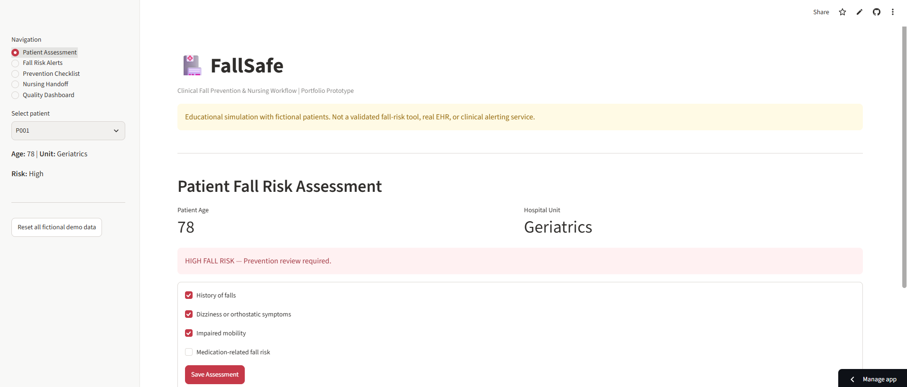
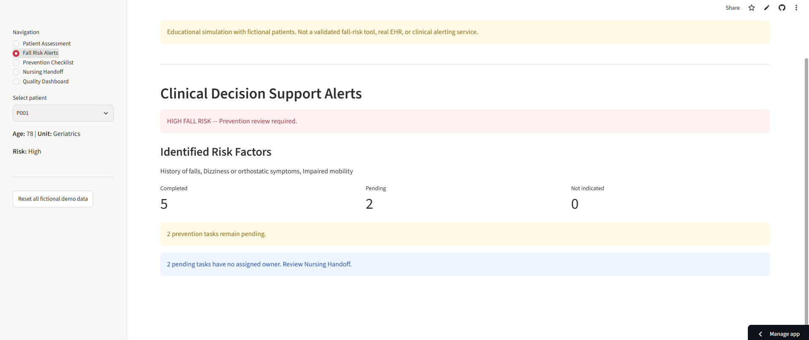
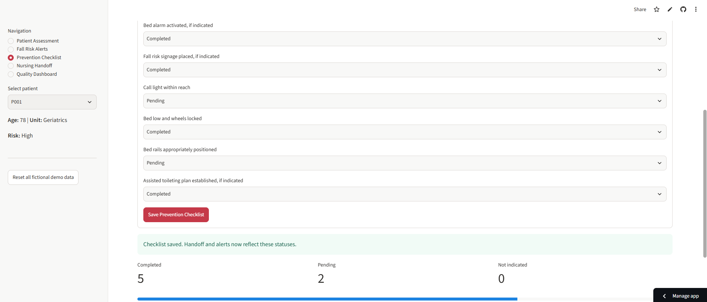
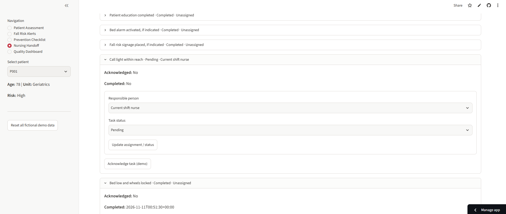
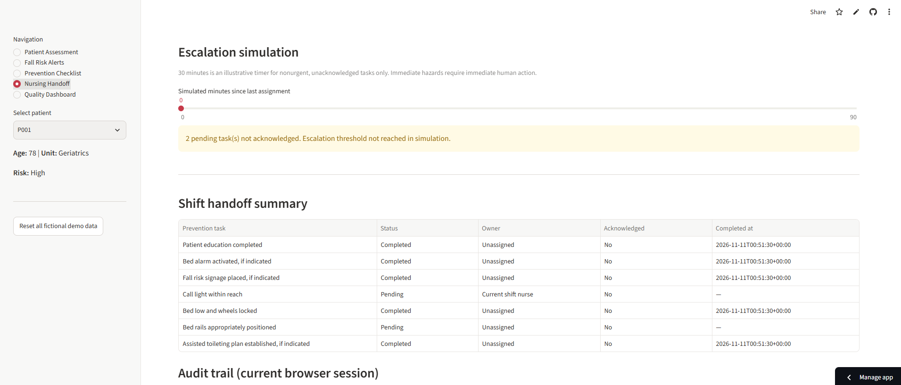
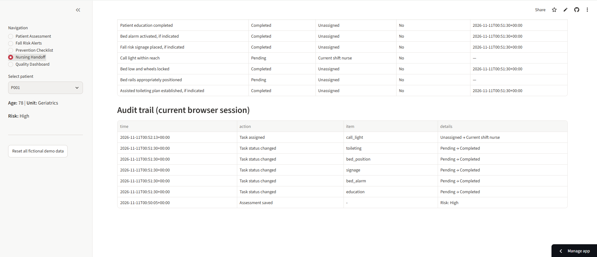
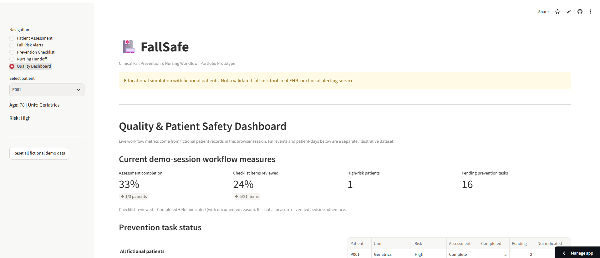
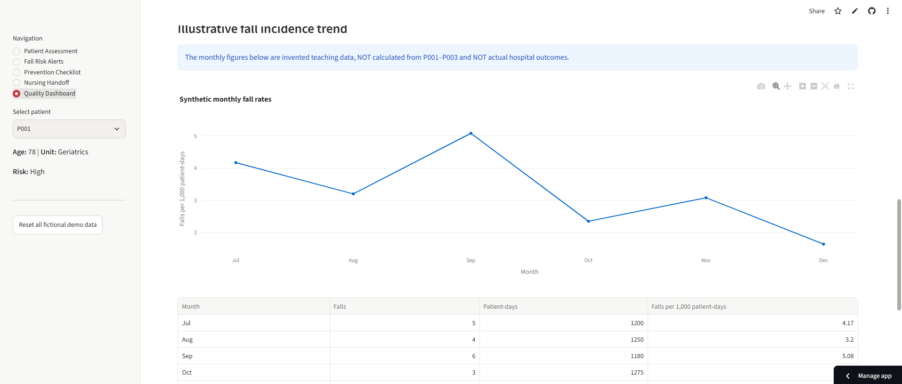
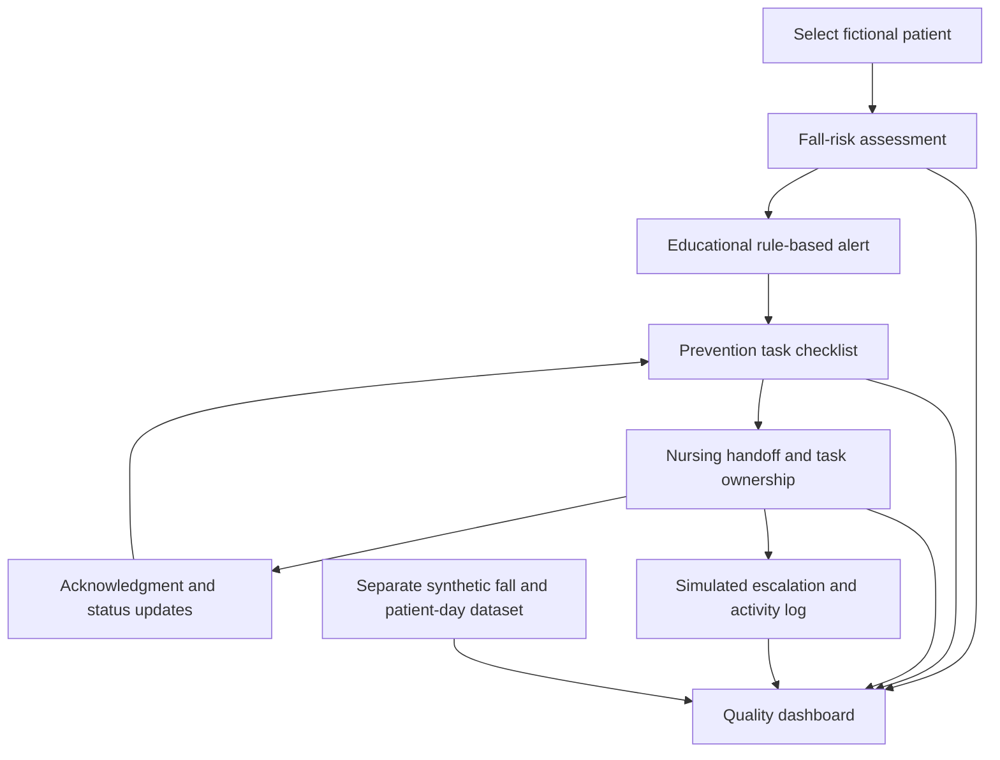

# FallSafe

**A nursing-informed clinical workflow and patient-safety analytics prototype**

[**Launch Live Demo**](https://fallsafe-clinical.streamlit.app/) · [**View Source Code**](https://github.com/katniss-chen/FallSafe)

> **Educational prototype only.** FallSafe uses fictional patient records and synthetic outcome data. It is not a validated fall-risk assessment instrument, a medical device, a production electronic health record (EHR), or a real clinical notification service. Do not use it for patient care or clinical decisions.

## Overview

FallSafe is an independently developed, interactive Streamlit application exploring how nursing workflows, clinical decision support (CDS), shift handoff accountability, and quality analytics can be connected to support **inpatient fall-prevention processes**.

The project starts from a common workflow challenge: when fall-risk assessment or prevention tasks are deferred during a busy shift, incomplete documentation can become difficult to distinguish from a completed assessment, and unresolved tasks can be lost during handoff. FallSafe demonstrates one possible information-system response: make incomplete assessments visible, connect prevention tasks to a shared patient record within the demo session, and surface unresolved work for review.

**Project focus:** Nursing Informatics · Clinical Workflow Design · Patient Safety · Healthcare Data Analytics

## The Clinical Workflow Problem

An illustrative scenario motivating the project:

1. A nurse must prioritize an urgent patient need and postpones a fall-risk assessment.
2. The incomplete assessment is not made sufficiently visible in the workflow.
3. Fall-prevention actions remain undocumented or uncompleted.
4. An unresolved task is not clearly assigned or acknowledged during shift change.
5. The care team has limited visibility into patterns of missed or delayed interventions.

FallSafe is a **design exploration**, not evidence that these failures occurred at a particular institution or that the prototype prevents falls.

## Implemented Features

| Module | What the prototype demonstrates |
| --- | --- |
| **Patient Assessment** | Four illustrative fall-related factors; assessment submission and explicit *Not assessed* status. |
| **Clinical Alerts** | Rule-based educational risk messages and visibility into incomplete assessments and pending prevention tasks. |
| **Prevention Checklist** | Seven configurable prevention tasks with *Pending*, *Completed*, and *Not indicated* statuses. |
| **Nursing Handoff** | Task assignment, acknowledgment distinct from completion, timestamps, handoff summary, and a session-level activity log. |
| **Escalation Simulation** | A manually adjusted 30-minute example threshold for nonurgent, unacknowledged tasks; simulated escalation entries only. |
| **Quality Dashboard** | Assessment and checklist workflow measures, task-status visualizations, handoff accountability, and a separately labeled synthetic fall-rate trend. |

### Clinical safety considerations built into the design

- **Missing assessment ≠ low risk.** An unassessed patient remains explicitly labeled *Not assessed*.
- **Acknowledgment ≠ completion.** Accepting responsibility for a task does not mean the bedside intervention was performed.
- **Checklist documentation ≠ verified care delivery.** Marking a task complete does not independently verify the action occurred.
- **Context matters.** Bed alarms, signage, bed rails, and assisted toileting must be assessed and used according to clinical judgment and local policy. Raising all bed rails is not a universal fall-prevention intervention.
- **Urgent hazards require immediate human action.** The 30-minute escalation timer is an illustrative simulation for nonurgent work, not a clinical response standard.

## Application Screenshots

The screenshots below show an educational workflow prototype using **fictional patients and synthetic data only**. FallSafe is not a validated clinical tool or a production EHR.

### 1. Patient Fall Risk Assessment
Demonstration assessment of fall-related factors and a rule-based review alert. The demonstration rule is not a validated fall-risk score.



### 2. Clinical Decision Support Alerts
Displays documented risk factors, outstanding prevention measures, and unassigned tasks.



### 3. Electronic Prevention Checklist
Tracks documented statuses for fall-prevention interventions. Documentation does not verify bedside completion.



### 4. Nursing Handoff and Task Ownership
Simulates task assignment, acknowledgment, and completion across nursing shifts within one browser session.



### 5. Escalation Simulation and Handoff Summary
Shows a hypothetical escalation timer for nonurgent, unacknowledged tasks and a structured shift summary. Urgent safety hazards require immediate action.



### 6. Session Audit Trail
Records simulated task changes and assessment actions during the current browser session; it is not a persistent or tamper-proof clinical audit log.



### 7. Quality and Patient Safety Dashboard
Summarizes fictional patient assessment completion, checklist review, and outstanding tasks in the current session.



### 8. Illustrative Fall Incidence Trend
Demonstrates a falls-per-1,000-patient-days calculation using a separate, invented teaching dataset. These figures are **not** actual hospital outcomes or measured effects of FallSafe.



---

## Workflow Architecture



**Data model:** Each fictional patient has an assessment, an illustrative risk label, prevention-task records, and a session activity log. The assessment, checklist, alerts, handoff, and workflow dashboard read from the same `st.session_state` records within one browser session. This provides cross-page consistency **within a session**, not cross-user synchronization.

## Analytics and Measures

The Quality Dashboard distinguishes between two data sources:

**1. Current demo-session workflow records**

- **Assessment completion:** assessed fictional patients ÷ total fictional patients.
- **Checklist items reviewed:** items marked *Completed* or *Not indicated* ÷ total checklist items. This is a documentation measure, **not** independently verified intervention adherence.
- **High-risk patients:** count flagged *High* by the prototype's illustrative rule.
- **Pending tasks:** prevention tasks still marked *Pending*.
- **Handoff accountability:** pending/unassigned, pending/unacknowledged, and currently escalated task counts.

**2. Separate synthetic monthly outcome examples**

The app illustrates a standard descriptive rate calculation:

\[
\text{Falls per 1,000 patient-days} = \frac{\text{Number of falls}}{\text{Patient-days}} \times 1,000
\]

The monthly fall counts and patient-days are invented examples. They are **not** generated by the three fictional patient records, are not real hospital results, and cannot establish a reduction in falls or a causal effect of FallSafe.

## Technology Stack

- **Python** — application logic and task-state handling
- **Streamlit** — interactive web interface and per-session state
- **Pandas** — tabular workflow and synthetic outcome data
- **Plotly Express** — interactive dashboard charts
- **GitHub** — source-code hosting and version history
- **Streamlit Community Cloud** — public demo deployment

## Run Locally

Requires a supported Python version and the dependencies listed in `requirements.txt`.

```bash
git clone https://github.com/katniss-chen/FallSafe.git
cd FallSafe
python -m pip install -r requirements.txt
streamlit run app.py
```

Alternatively, use the [live demonstration](https://fallsafe-clinical.streamlit.app/).

## Suggested Demo Walkthrough

1. Open **Patient Assessment**, select `P001`, and record two illustrative risk factors.
2. Open **Clinical Alerts** to view the educational high-risk warning.
3. Open **Prevention Checklist** and update the bed-alarm task status.
4. Open **Nursing Handoff**, assign an owner, and acknowledge the task. Notice that acknowledgment does **not** mark the task complete.
5. Mark the task *Completed* and verify the checklist and alert-related task counts reflect the update.
6. Use **Escalation Simulation** to illustrate a nonurgent, unacknowledged task threshold; no real message is sent.
7. Open **Quality Dashboard** to explore session workflow measures and the separately labeled synthetic fall-rate chart.

## Current Limitations

- **Fictional data only:** Three demonstration patient profiles; no real protected health information (PHI) is required or intended.
- **Unvalidated assessment logic:** The four-factor count is an educational rule, not a validated fall-risk instrument or substitute for professional assessment.
- **Session-only state:** `st.session_state` is not a persistent database. Data may reset on refresh, reconnection, or session termination; different visitors do not share a clinical record.
- **No real integrations:** No EHR, HL7/FHIR interface, authentication, role-based access control, clinical messaging, or production audit-log storage.
- **No real-time escalation:** The timer is adjusted manually; the prototype does not run a background scheduler or notify a charge nurse.
- **No clinical validation:** No usability study, prospective evaluation, patient outcome study, or security assessment has been conducted.

## Potential Future Directions

These are **ideas for future development**, not implemented features:

- Secure database-backed, multi-user task synchronization and access controls
- Configurable unit-specific policies and clinically reviewed escalation pathways
- Formal usability testing with nursing stakeholders
- Interoperability experiments using **synthetic** FHIR resources
- Better distinction between documentation completion, verified interventions, and outcome measures
- Evaluation plans for alert fatigue, workflow burden, and equity across patient populations

## Project Background

FallSafe was conceived as an independent portfolio project informed by nursing experience and graduate study in Health Informatics. It demonstrates the translation of a clinical workflow problem into a functional software prototype and an exploratory quality-improvement dashboard.

**Developer:** Yi Ting (Katniss) Chen, RN, BSN, BBA  
**Graduate studies:** M.S. in Health Informatics, DePaul University

## Disclaimer

FallSafe is for learning, demonstration, and portfolio review. All patient identifiers, assessment entries, task records, and displayed outcomes are fictional or user-generated within a demonstration session. The prototype must not be used for diagnosis, risk stratification, treatment decisions, real patient documentation, or hospital operations.
