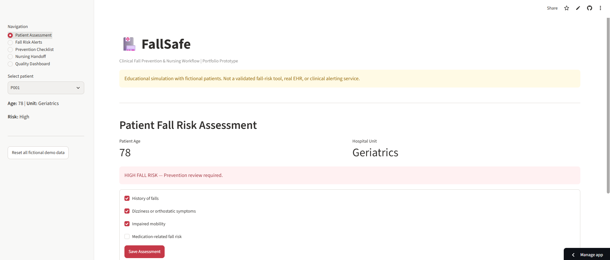
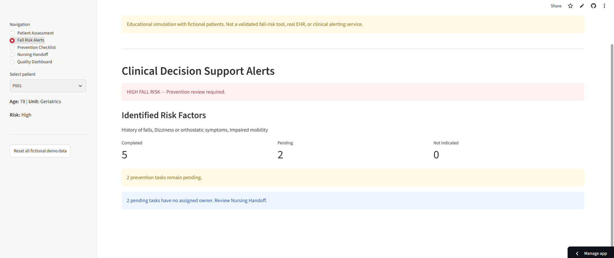
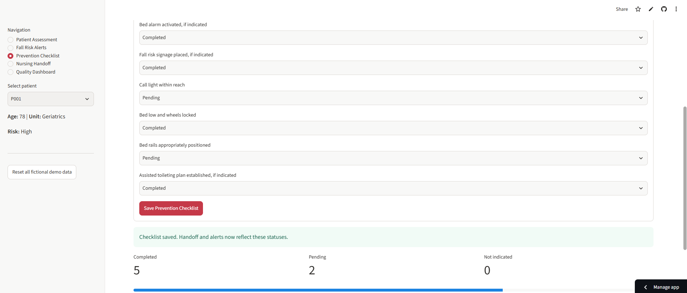
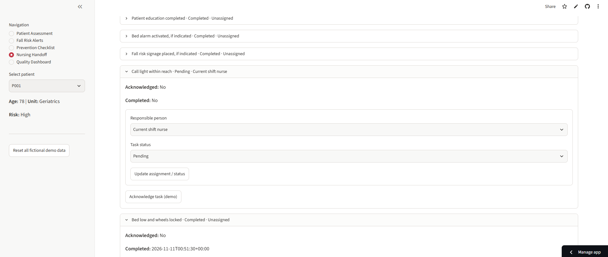
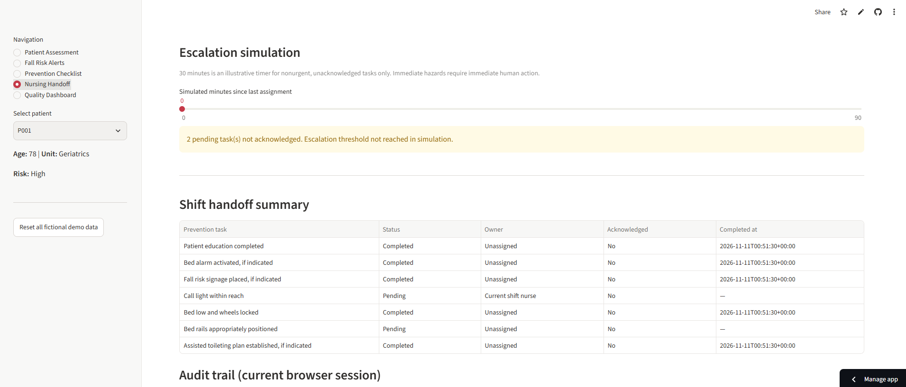
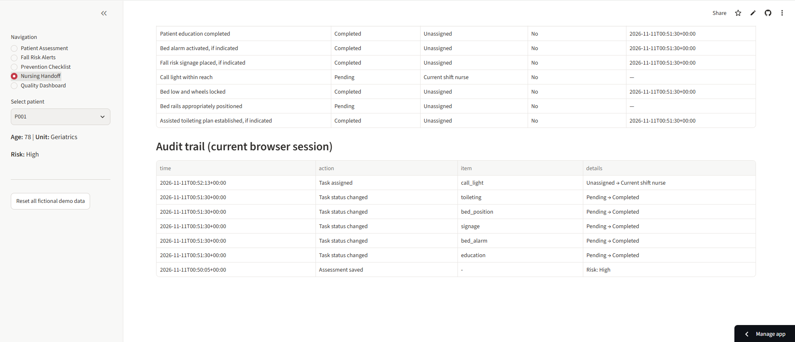
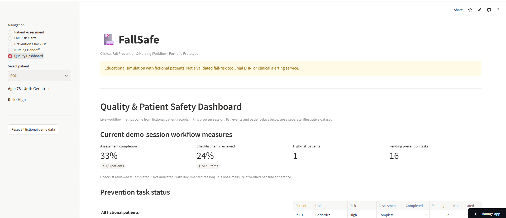
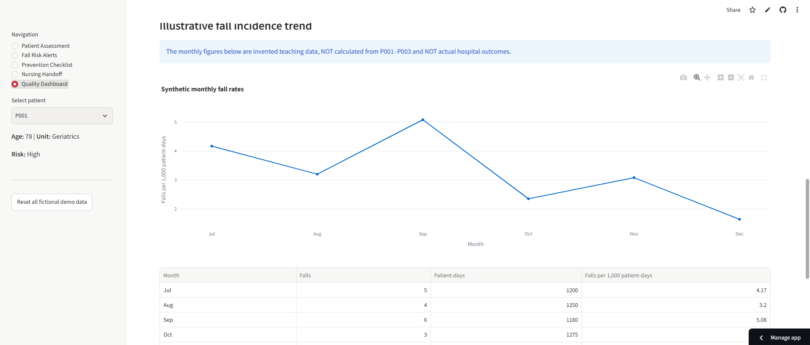

## Application Screenshots

The screenshots below show an educational workflow prototype using **fictional patients and synthetic data only**. FallSafe is not a validated clinical tool or a production EHR.

### 1. Patient Fall Risk Assessment
Demonstration assessment of fall-related factors and a rule-based review alert. The demonstration rule is not a validated fall-risk score.

### 2. Clinical Decision Support Alerts
Displays documented risk factors, outstanding prevention measures, and unassigned tasks.

### 3. Electronic Prevention Checklist
Tracks documented statuses for fall-prevention interventions. Documentation does not verify bedside completion.

### 4. Nursing Handoff and Task Ownership
Simulates task assignment, acknowledgment, and completion across nursing shifts within one browser session.

### 5. Escalation Simulation and Handoff Summary
Shows a hypothetical escalation timer for nonurgent, unacknowledged tasks and a structured shift summary. Urgent safety hazards require immediate action.

### 6. Session Audit Trail
Records simulated task changes and assessment actions during the current browser session; it is not a persistent or tamper-proof clinical audit log.

### 7. Quality and Patient Safety Dashboard
Summarizes fictional patient assessment completion, checklist review, and outstanding tasks in the current session.

### 8. Illustrative Fall Incidence Trend
Demonstrates a falls-per-1,000-patient-days calculation using a separate, invented teaching dataset. These figures are **not** actual hospital outcomes or measured effects of FallSafe.

